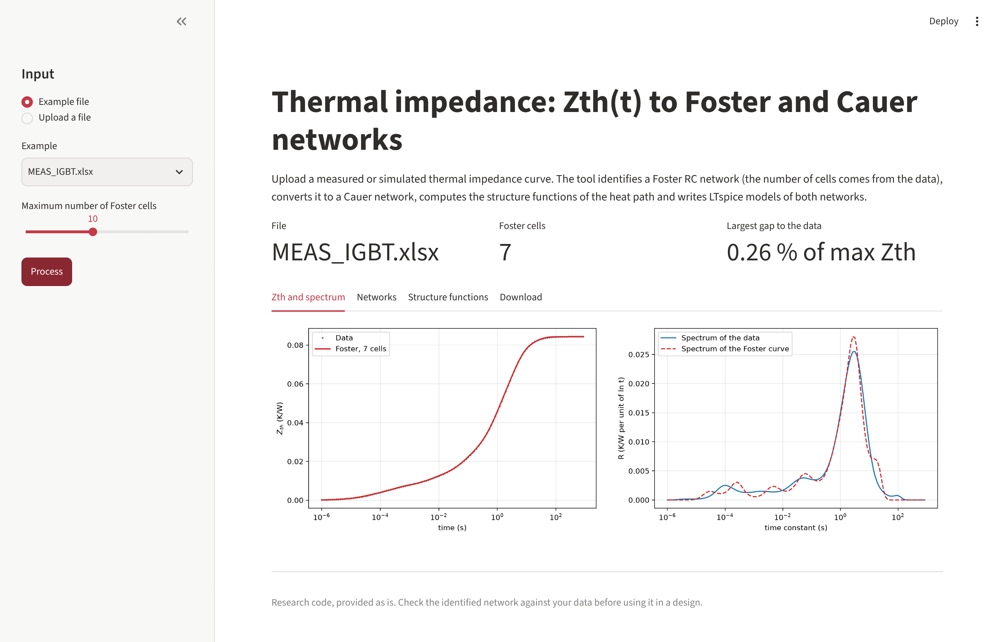

# Thermal Impedance Analysis (Zth to Foster and Cauer)

Turns a thermal impedance curve $Z_{th}(t)$, measured or simulated, into a
Foster RC network, a Cauer RC network, the structure functions of the heat
path and LTspice models. The number of RC cells and their time constants come
from the data, by network identification by deconvolution, then a
least-squares fit.



## Online version

Nothing to install: upload a file (or pick an example), click *Process*, read
the two networks and the structure functions, download the results.

Online: https://thermalimpedanceanalysis.streamlit.app.

## Run it on your computer

Python 3.12 or later.

```bash
# web version
pip install -r webapp/requirements.txt
streamlit run webapp/app.py

# window and command line
pip install -r thermal_analysis/requirements.txt
python -m thermal_analysis                                                   # window
python -m thermal_analysis -file thermal_analysis/input_data/MEAS_IGBT.xlsx  # command line
```

Run these from this folder. The package, its documentation and the sample
curves are in [`thermal_analysis/`](thermal_analysis/README.md); start with
[`thermal_analysis/docs/README.md`](thermal_analysis/docs/README.md).

The web version calls the same `thermal_analysis.analyse` as the command line
(`webapp/test_webapp.py` checks that the tables are identical). It needs
neither PyRth nor tkinter. Its structure functions come from the Cauer
network, as in the command line; the window computes them with PyRth.

## Folder content

| Path | Content |
|---|---|
| `thermal_analysis/` | the tool: package, window, command line, documentation, sample curves |
| `webapp/` | web version (Streamlit) and its tests (`pytest webapp -q`) |

## Help and licence

Questions and bug reports: Jules Scraigne (jules.scraigne@gmail.com).
Licence: MIT.
