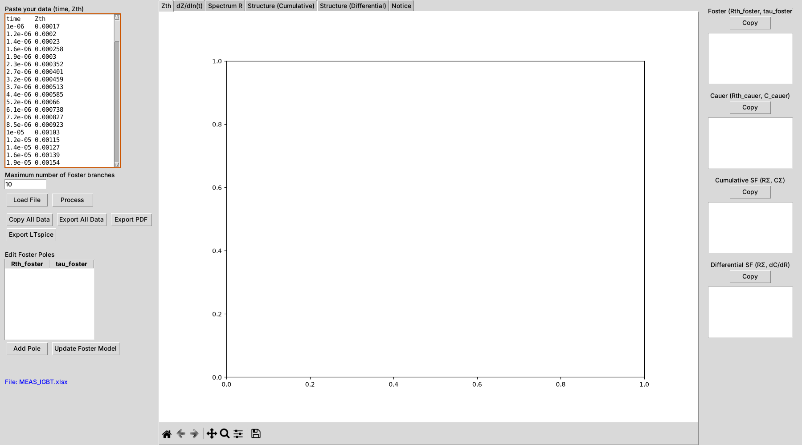

# Tutorial: first analysis of an IGBT measurement

This tutorial takes a measured thermal impedance through the whole tool,
from the file to the Foster network and the PDF report. At each step it says
what you should see, so that you can tell whether the step worked. It takes
about ten minutes.

Before you start, you need:

- the tool installed (see [Installation](installation.md));
- the file `thermal_analysis/input_data/MEAS_IGBT.xlsx`, delivered with the
  tool.

`MEAS_IGBT.xlsx` holds the measured $Z_{th}(t)$ of an IGBT: 126 points from
1 µs to 850 s, logarithmically spaced, in two columns named `time` (s) and
`Zth` (K/W). The curve ends on a plateau at 0.0844 K/W, the thermal
resistance of the measurement set-up.

## 1. Start the tool

From the folder that contains `thermal_analysis`, run:

```bash
python -m thermal_analysis
```

or run `thermal_analysis/__main__.py` from your editor. The window *Thermal Impedance Analysis tool* opens. The controls are on the
left, the plots in the middle, and the result tables on the right.

## 2. Load the measurement

1. Click *Load File*.
2. Select `thermal_analysis/input_data/MEAS_IGBT.xlsx`.

The data box at the top left fills with two columns, under the header line
`time Zth`, and gets an orange frame. The orange frame means that the data
changed and hasn't been processed yet. Below the buttons, the status reads
`File: MEAS_IGBT.xlsx`.



*The window after Load File. The orange frame marks data not yet processed.*

## 3. Process the data

1. Leave *Maximum number of Foster branches* at 10.
2. Click *Process*.

The window freezes while it computes; this is normal. The status line shows
the steps one after the other: `Running PyRth evaluation...`,
`Optimizing M values (parallel)...`,
`Optimizing tau values (parallel)...`,
`Refining Foster fit (global least-squares)...`. After 10 to 30 s,
depending on the computer, it reads
`Processed successfully`, and the orange frame disappears.

## 4. Check the fit

The *Zth* tab shows the measured curve (solid) and the curve rebuilt from the
Foster network (dashed). Check that the dashed curve lies on the solid one
over the whole time range, from the first microseconds to the plateau.


*After Process: the Foster curve follows the measurement within 0.3 % of the final value.*

On this file the largest gap between the two curves is 0.22 mK/W, about
0.3 % of the final value. You can zoom with the magnifier of the toolbar
under the plot.

## 5. Read the Foster network

The *Edit Foster Poles* table, on the left, and the *Foster* table, top
right, give the network. Each row is one cell of the network: a thermal
resistance `Rth_foster` in K/W and a time constant `tau_foster` in s. You
should get these seven rows:

| Rth_foster (K/W) | tau_foster (s) |
|---|---|
| 0.00439223 | 0.000245016 |
| 0.00425624 | 0.00419056 |
| 0.00843105 | 0.0536846 |
| 0.0201216 | 0.643439 |
| 0.035766 | 3.09774 |
| 0.00887303 | 15.5164 |
| 0.00245355 | 2.7847e-05 |

The resistances add up to 0.0843 K/W, the final value of the curve.

The rows aren't sorted by time constant. The first six cells come from the
time-constant spectrum; the last one, at 28 µs, was added by the
least-squares step, because the root mean square error of the six-cell fit
was above 0.2 % of the range of the curve. [How the identification works](method.md) explains
each step.

## 6. Look at the time-constant spectrum

Click the *Spectrum R* tab. The solid curve is the time-constant spectrum of
the measurement: each peak is a group of time constants, and the area under
a peak is the thermal resistance of that group. The dashed curve is the
spectrum of the Foster network.


*The largest peak, near ln t = 1 (about 3 s), carries most of the thermal resistance.*

## 7. Look at the structure functions

Click the *Structure (Cumulative)* tab. The cumulative structure function
plots the cumulative thermal capacitance, $C_\Sigma$, against the cumulative
thermal resistance, $R_\Sigma$, measured from the junction. A relatively flat
region indicates a large increase in thermal resistance with little
additional thermal capacitance, which may be associated with a thermally
resistive, low-capacitance region such as an interface layer. Conversely, a
steep region indicates a large increase in thermal capacitance for a
relatively small increase in thermal resistance, as may occur in a massive
component such as a heat sink.


*The red line marks the last point of the structure function, 0.084 K/W: the measured thermal resistance.*

The red line stands at 0.084 K/W, the final value of the measurement: the
structure function covers the whole heat path, from the fastest cell at
28 µs to the ambient.

The *Cauer* table, on the right, gives the Cauer network equivalent to the
Foster network: one resistance `Rth_cauer` (K/W) and one capacitance
`C_cauer` (J/K) per cell, from the junction to the ambient. Its first rows
are:

| Rth_cauer (K/W) | C_cauer (J/K) |
|---|---|
| 0.00355304 | 0.00932396 |
| 0.00395765 | 0.0562569 |
| 0.00547674 | 0.854345 |

Its resistances add up to the same 0.0843 K/W as the Foster network, but
each value is different: a Foster cell and a Cauer cell don't describe the
same thing (see [Foster and Cauer networks](method.md#foster-and-cauer-networks)).

## 8. Save the results

1. Click *Export PDF* and save `MEAS_IGBT.pdf`. The report has 20 pages: the
   five plots, then tables of the Foster and Cauer networks, of the
   structure functions, and of the data with the rebuilt curve.
2. Click *Export All Data* and save `MEAS_IGBT.xlsx`. The Excel workbook has
   one sheet per result: *Summary*, *Zth*, *Foster*, *Cauer*, *Cumulative SF*
   and *Differential SF*.
3. Click *Export LTspice* and choose a folder. It receives two LTspice
   models, `MEAS_IGBT_FOSTER.net` and `MEAS_IGBT_CAUER.net`, each with its
   symbol (`.asy`) and its test bench (`_testbench.net`), which you can open
   and run in LTspice (see
   [Export the network to LTspice](howto.md#export-the-network-to-ltspice)).

The *Foster* sheet holds the 7 cells, sorted by time constant, with their
capacitances. [Export the results](howto.md#export-the-results) describes the
other formats, CSV included.

## Next steps

- To analyse your own data, see
  [Prepare an input file](howto.md#prepare-an-input-file).
- To understand the steps and their settings, read
  [How the identification works](method.md).
